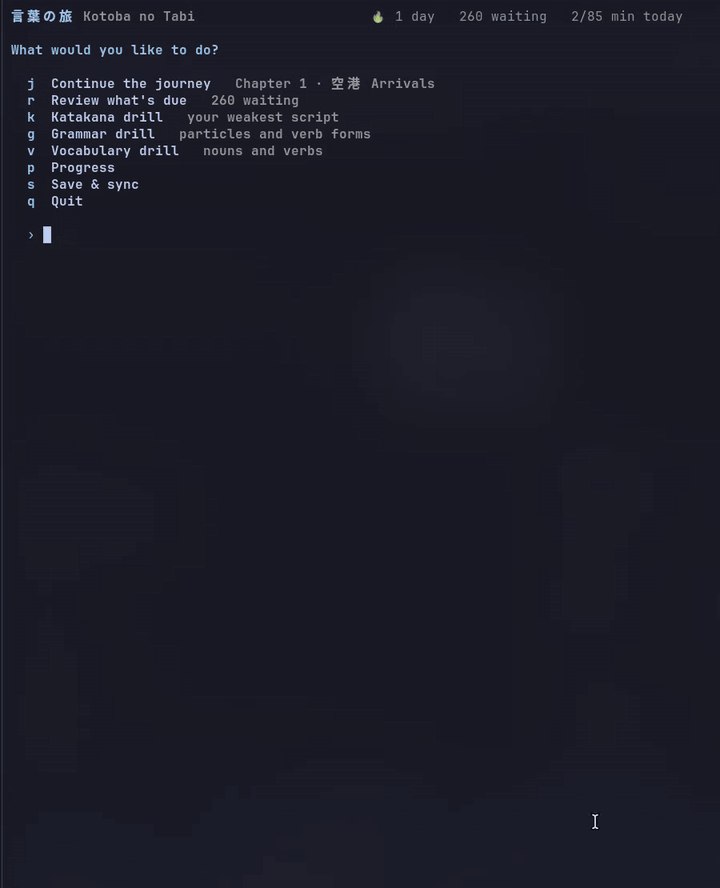

# 言葉の旅 · Kotoba no Tabi

A terminal adventure for learning Japanese to JLPT N5. Eight chapters of a
journey through Japan, with a spaced-repetition engine underneath.

    kotoba              # main menu
    kotoba review       # straight into what's due
    kotoba progress     # progress and exam pacing

## Installing

Not on the AUR yet. Until then:

**Arch** — build from the PKGBUILD in this repo:

    git clone https://github.com/Draper1/kotoba-no-tabi.git
    cd kotoba-no-tabi/packaging && makepkg -si

**Anywhere else** — Python 3.11+, one dependency (`rich`):

    pipx install git+https://github.com/Draper1/kotoba-no-tabi.git

Or `pip install --user .` from a clone, if you'd rather skip pipx.

## The one rule

Nothing here is ever marked wrong. A card you don't get is one you haven't
finished learning *yet*: the game shows you the answer, tells you why, and
brings it back a few cards later while it's still fresh. There is no failure
count anywhere, and red is never used for anything you typed.

Press **Enter** on a card you don't know and it simply shows you — no penalty
for saying "I don't know". Type `:q` to stop.

## Answering

Type romaji or real kana; both are accepted and normalised the same way. All of
these are the same answer:

    コーヒー    koohii    kouhii    kōhī    こーひー    ko-hi-

Typos are forgiven when they're clearly typos, but never when the thing you
typed is itself a real word — `kimasu` is 来ます, not a slip for 行きます, so
that one gets taught rather than waved through.

## What's in it

| | |
|---|---|
| kana | 208 (hiragana + katakana, with mnemonics for the confusable pairs) |
| vocabulary | 707 words — the full JLPT N5 list, including counters and dates |
| kanji | 117, with 186 example words |
| grammar | 72 points, 166 drill sentences |
| **cards** | **2,203** |

Each word becomes several cards, because recognising 食べる and producing it
from "to eat" are different skills, and the ます-form is a third.

## Chapters

Each chapter is a place, and teaches what you'd need to survive it. Vocabulary
comes first, then the grammar that uses it.

1. 空港 Arrivals · 2. 駅 The Station · 3. 食堂 The Noodle Shop · 4. 店 The Market
5. 学校 The School · 6. 家 The House · 7. 町 The Town · 8. 旅館 The Inn

A chapter opens the next once you've met 85% of its cards and 60% are holding.

## Your save

One SQLite file at `~/.local/share/kotoba/save.db`.

Reviews are stored as an **append-only log**; scheduling state is derived from
it and can be rebuilt at any time. That's what makes moving between machines
safe — merging is a union of two logs plus a replay, with no conflicts to
resolve:

    kotoba export > save.json     # machine A
    kotoba import save.json       # machine B — merges, never overwrites

Importing the same file twice changes nothing. Remote sync isn't wired up yet;
this is the seam it will use.

## Typing Japanese

fcitx5 + mozc are installed. **Ctrl+Space** toggles between English and
Japanese. You don't need it — romaji works everywhere — but it's there when you
want to practise real input.

## Adding content

The JSON files in `kotoba/content/` are the whole course. Adding a word to
`vocab.json` adds cards on the next run; card ids are stable, so nothing you
already know is disturbed.

    python3 tests.py    # 22 tests, mostly guarding the answer checker
